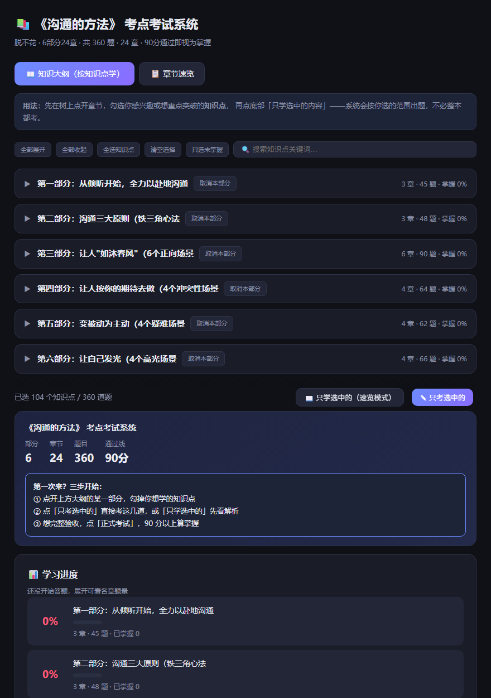
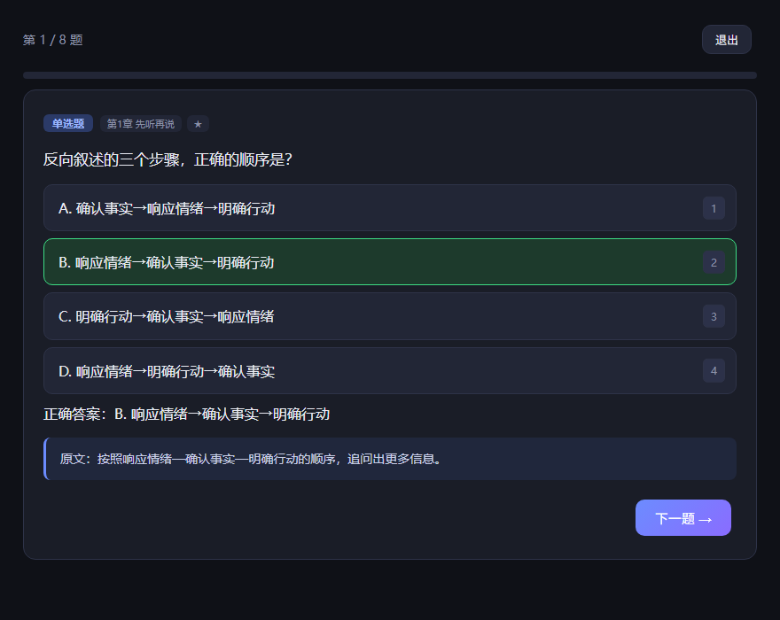
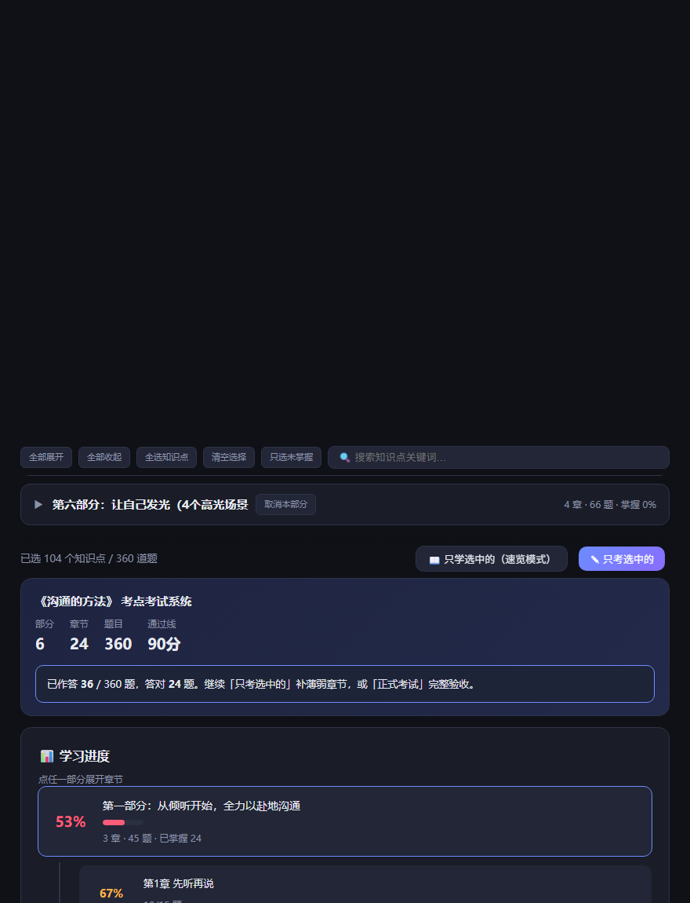

# book-to-exam-skill

**把一本书变成一套可以「考过才算读懂」的系统。**
纯选择题 · 交互式考试网页 · 知识大纲树 · Anki 闪卡 —— 全部离线生成，零外部依赖。



> 上图为《沟通的方法》：6 大部分 / 24 章 / 360 题 / 104 个知识点。

---

## 30 秒看懂

读完一本书，究竟记住了多少，其实没法验证。

这套系统把它换成一个可判定的数字：**考到 90 分**。
更进一步——你不必考整本书。勾掉不感兴趣的部分，只考你选的那几道。

| | |
|---|---|
| **① 选书** | 网页上传，或本地 PDF。自动切章 |
| **② 出题** | AI 读章节，产出概念题 / 场景题 / 案例题 |
| **③ 验收** | 90 分通过 = 视为掌握。不合格就只补薄弱章节 |

**全程零输入框** —— 不填空、不写长段文字，全部点选。

---

## 界面长这样

**答题与解析**（选中即判分，数字键 `1`–`6` 可直接选）



**学习进度**（按部分聚合，点开才看章节 —— 不再是 24 个格子平铺）



---

## 快速开始（验证安装）

仓库带一套**自包含演示数据**（自编内容，非任何真实出版物）：

```bash
git clone https://github.com/gaoren7716-lab/book-to-exam-skill.git
cd book-to-exam-skill

# ① 构建 → 生成考试网页
python book-to-exam/scripts/build_exam.py \
  --book-dir "examples/demo-节奏管理" \
  --title "《节奏管理》" --subtitle "示例自编 · 2部分4章" --pass-score 90

# ② 打开考试网页
start examples/demo-节奏管理/考试系统.html      # Windows
open  examples/demo-节奏管理/考试系统.html      # macOS

# ③ 跑交互回归测试（18 项，应全部 PASS）
node tools/regression_test.js
```

预期：48 题（概念 36 + 场景 8 + 案例 4）、2 部分 / 4 章 / 23 知识点、挂载 48/48。

---

## 处理自己的书

### 方式一：网页上传（TXT / Markdown）


双击打开 `book-to-exam/assets/上传切章.html`，选文件 → 填章节正则 → 导出章节包。
**全程在浏览器内完成，文件不上传任何服务器。**

### 方式二：PDF 切章（推荐，保留书签目录）

```bash
python book-to-exam/scripts/split_pdf.py "你的书.pdf" --out "./我的书"
```

自动优先用 PDF 书签切章，无书签时回退到正则。产出：

```
我的书/
├── chapters/01_章名.txt ...   每章一个
├── 书籍信息.json             章节清单 + 字数统计
└── 全文.txt                   分章拼接，可直接投喂 AI
```

> 已在两本真实书上验证：一本 330 页 → 24 章，另一本 397 页 → 66 章，均走 PDF 书签目录。

### 接着出题

把章节目录告诉 AI，说「**按 book-to-exam 流程给这本书出考试系统**」，然后：

```bash
python book-to-exam/scripts/build_exam.py \
  --book-dir "./我的书" --title "《我的书》" --subtitle "作者 · N部分N章" --pass-score 90
```

### ⚠️ 为什么出题这一步还需要 AI

切章是纯文本处理，脚本就能做完。但「哪句是核心方法、哪个案例能出场景题、干扰项该取哪章的术语」
需要真正理解原文 —— 这是纯前端 JS 做不到的。

**分工：脚本负责把书拆干净，AI 负责把书读懂。**

---

## 三个核心设计

### 1. 全程只做选择题

不出现填空框，不出现长文本框。遇到看似只能填空或简答的考点：

| 原考点形态 | 改造成选择题 |
|-----------|-------------|
| 填空（挖术语/步骤名） | 题干保留情境，4 个选项 ＝ 正确术语 + 3 个**书中其他章节**的似是而非术语 |
| 简答（要写要点） | 改为「以下哪项最完整/最符合……」，正确项覆盖原要点，另 3 项残缺或走偏 |
| 步骤顺序 | 「下列顺序正确的是」，正确顺序与打乱顺序对比 |
| 概念辨析 | 「以下说法错误的是」，四个都是书中说法，错的那个即为答案 |

构建脚本用高精度正则拦截所有需要打字的题目，**含无横线的填空思维化石**（"被填进去的词是哪一个？""赞美=打追光+轻轻地+某一个词"）。

### 2. 三种题型，每章必出

| 类型 | 每章 | 用途 |
|------|-----|------|
| `choice` | 9 | 概念原理：定义、步骤名、原则、顺序、辨析 |
| `scenario` | 2 | 真实情境该怎么做，**干扰项取自本书其他章节的方法** |
| `case` | 1 | 书中真实案例体现什么原则 |

只考记忆会"背了不会用"。场景题干扰项跨章取方法，跨章混淆才有真实难度。

### 3. 知识大纲树：勾选式定向学习

首页默认是三级树 **部分 → 章 → 知识点**，每节点显示题量与掌握度。

- 勾任意知识点 / 整章 / 整部分 → 「**只学选中的**」看答案解析，「**只考选中的**」只考这几道
- 「**只选未掌握**」按掌握度自动挑出薄弱知识点
- **范围回显**：考试范围 ＝ 大纲选中 ∩ 章节勾选 ∩ 题型筛选，首页明写当前多少题
  （避免"勾了知识点但考试范围没变"的假象）

---

## 目录结构

```
book-to-exam-skill/
├── README.md
├── LICENSE
├── book-to-exam/                    ← Skill 本体，可直接拷进 skills 目录
│   ├── SKILL.md                     执行规则（拆书 / 命题 / 构建 / 校验）
│   ├── assets/
│   │   ├── 考试系统_模板.html         自包含考试网页模板
│   │   └── 上传切章.html             网页上传切章页
│   └── scripts/
│       ├── split_pdf.py             PDF 切章（书签优先，正则回退）
│       ├── build_exam.py            合并卡片 + 校验 + 生成 JSON/HTML/Anki
│       ├── build_outline.py         解析知识框架 → 大纲树 → 挂载题目
│       └── build_portal.py          多书聚合总控页
├── examples/demo-节奏管理/          ← 一分钟可跑的演示数据（自编）
├── tools/regression_test.js         ← 18 项 DOM 桩交互回归（实时读网页）
└── docs/
    ├── 出题手册.md                   写卡片的规范与正反例
    ├── 校验清单.md                   交付前机械校验清单
    └── 交互增强明细表.md             待实施的交互升级方案
```

---

## 作为 Agent Skill 使用

把 `book-to-exam/` 放进 skills 目录：

```
~/.workbuddy/skills/book-to-exam/     # WorkBuddy
~/.claude/skills/book-to-exam/        # Claude Code
```

`SKILL.md` 带 YAML frontmatter 与触发词，当你说「把这本书做成考试系统」「以考代学」
「生成考点」「我要背这本书」时自动触发。

---

## 常见坑

| 坑 | 应对 |
|----|------|
| 子代理产出填空/简答 | 构建脚本直接拒收并逐条报告，按上文对照表改造成选择题后重跑 |
| **无横线的填空思维化石** | 正则连同全角＿、空括号、"填空/依次应填/请简述"、"被填进/横线/空格"一起拦截 |
| 记忆题与应用题 ID 撞车 | 构建脚本按「章+题型」重新编号（`c`/`x`/`k`），原 ID 存入 `srcId` |
| **大纲挂载率崩塌**（兜底 >30%） | 九成是知识框架太粗：加**加粗术语**或**引号**包住方法名；要点用 `→` 连接时别漏箭头 |
| 章节写成 `### 第1章` 导致大纲 0 章 | 解析器只认 `### ① …` 圈号格式 |
| 零填空扫描误报 | **扫题库 JSON，不要扫整份 HTML** —— JS 的 `selectWeak()` 会命中"空括号"，快捷键提示会命中"空格" |
| 模板占位符注入 JS 报语法错 | 纯文本占位符与字符串字面量分开（`__BOOK_TITLE__` / `__BOOK_TITLE_JSON__`），交付前必须 `node --check` |
| 长书塞爆上下文 | 按 `ceil(正文页数 / 20)` 估算并行子代理数 |

---

## License

MIT，见 [LICENSE](LICENSE)。

**内容版权提醒**：本仓库只发布**工具与自编演示数据**。用它处理你自己的书时，
产出的题目与解析属于个人学习用途，请勿将原书内容公开发布或用于商业用途。