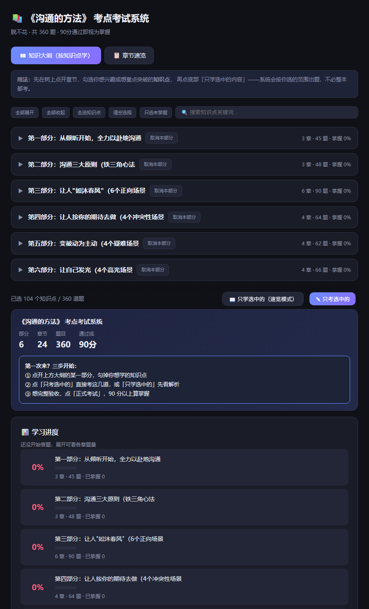
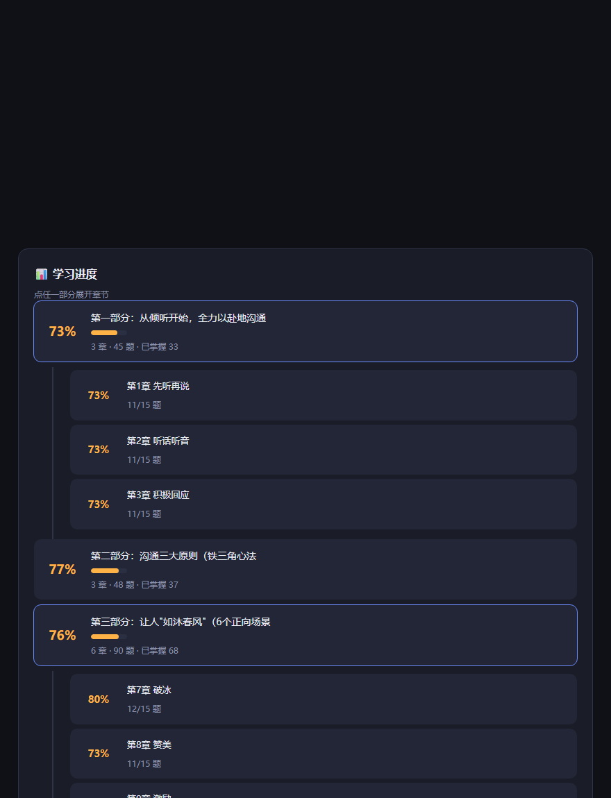
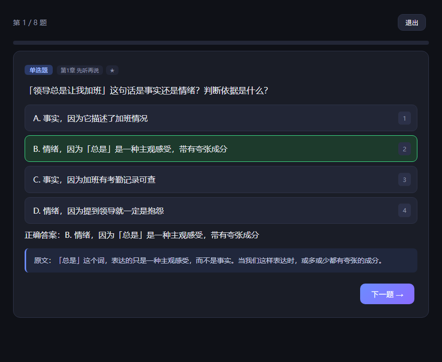
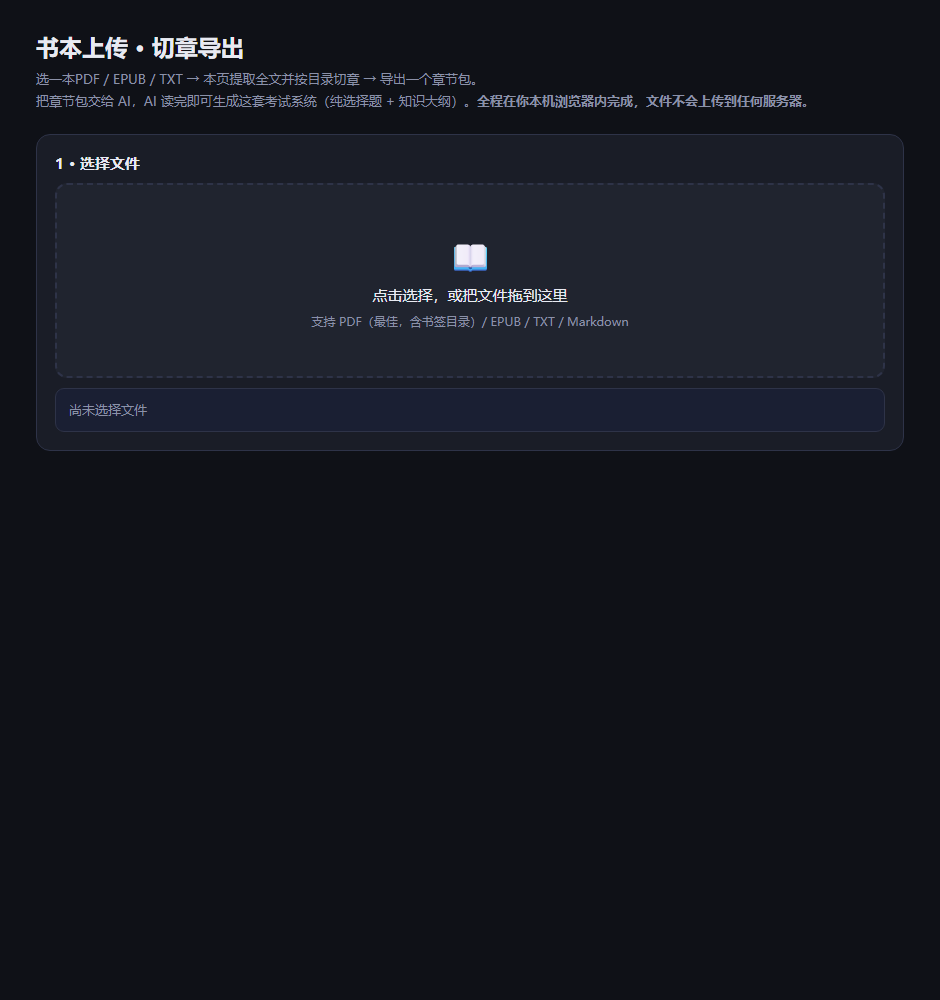
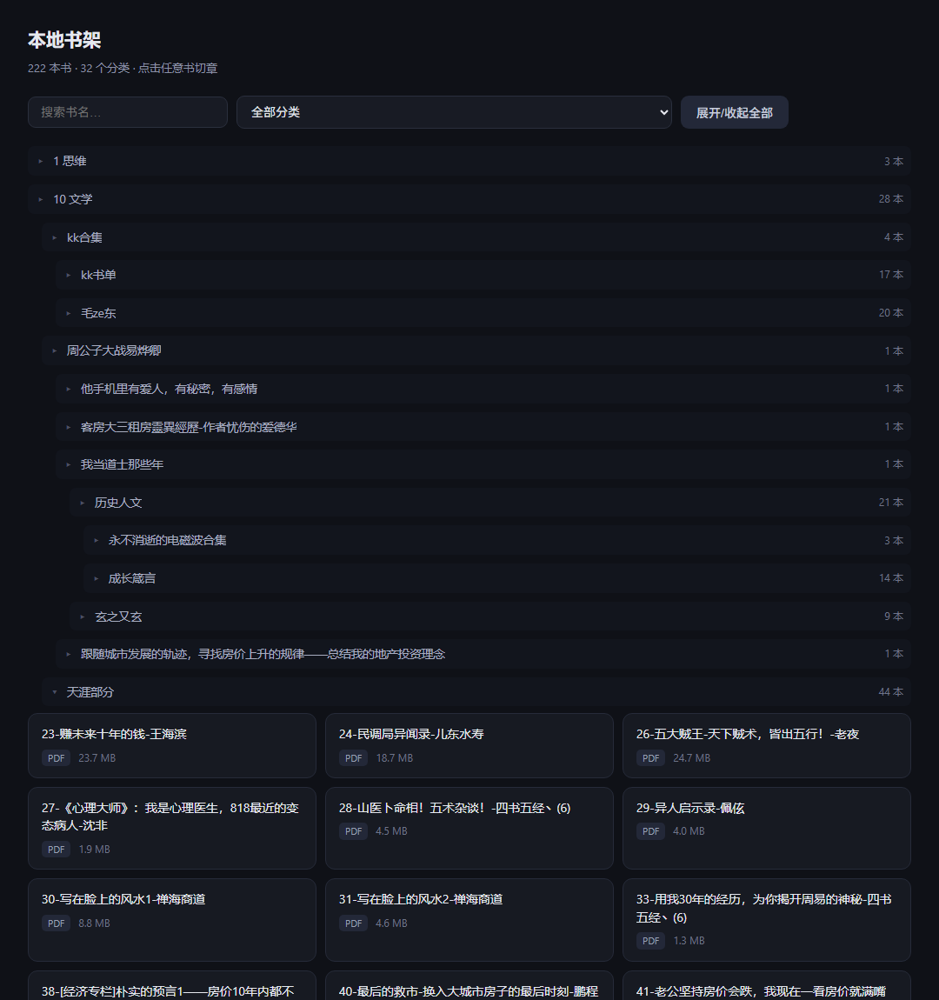

<div align="center">

#📖 book-to-exam

**把一本书变成一套可以考核的系统**

知识框架 →纯选择题库 → 交互式考试网页 → Anki 闪卡

`考过设定分数线，即视为掌握全书`

[](LICENSE)

</div>

---

## 它长什么样

### 1. 首页：知识大纲树，按知识点挑着学



不考整本。展开大纲、勾选感兴趣的**知识点**，系统只考你选的范围。

### 2. 学习进度：按部分聚合，不铺24 个格子



点任一部分展开看章节；点章节直接跳到大纲对应位置。

### 3. 答题：点选即判分，附原文出处



数字键 `1`–`6` 选选项，`回车` 下一题。

### 4. 上传自己的书



---

## 快速开始

```bash
git clone https://github.com/gaoren7716-lab/book-to-exam-skill.git
cd book-to-exam-skill

# ① 跑一遍自带演示数据（48 题 / 4 章 / 23 知识点）
python book-to-exam/scripts/build_exam.py \
  --book-dir "examples/demo-节奏管理" \
  --title "《节奏管理》" --subtitle "示例自编" --pass-score 90

# ② 打开产物开始考
start examples/demo-节奏管理/考试系统.html

# ③ 跑交互回归（需要 Node）
node tools/regression_test.js
```

**做自己的书**：见下面「两种入口」。

---

## 两种入口

### 方式一：本地书架网页（推荐）

```bash
python book-to-exam/scripts/书架.py "E:\0 书架"
```

浏览器自动打开，扫描你的书库 → **点书 → 自动切章 → 生成给我执行的指令** → 复制粘贴给我即可出题。

支持 PDF / EPUB / TXT / Markdown，自动清理文件名里的盗版站标记，
分类按目录层级缩进显示。切章失败时会明确告诉你是扫描版还是 EPUB 无标题。



### 方式二：命令行切章

```bash
python book-to-exam/scripts/split_book.py "D:\书架\书名.epub" --out "./书名"
```

同样支持四种格式。PDF 优先走书签目录；EPUB 会自动把碎片归并成正式章节，
并把多册合集（如《鲁迅全集》20 册）按册拆开。

> **一个技术现实**：切章脚本能做，但「哪句是核心方法、哪个案例能出场景题、干扰项该取哪章的术语」
> 必须 AI 读懂原文——纯前端 JS 做不到。分工是：**脚本把书拆干净，AI 把书读懂。**
>
> 所以网页不会「一键出考试系统」，它省掉的是记路径、找书、开终端这些事。

---

## 形态选择

| 想要 | 建议 | 理由 |
|---|---|---|
| 自己用，快速出题 | **本地书架网页** | 零安装、点书即可，出题交给 AI |
| 发给别人用 | 部署成静态网页 + GitHub | 考试系统本身是自包含单文件 HTML |
| 打包成 exe | 不建议 | 唯一好处是双击图标，能力与网页完全相同，但 40–80MB、改代码要重打包 |
| 手机 APP / 小程序 | 只适合「刷题」 | 手机上跑不了切章 + 出题。可把考试网页套壳成小程序，逻辑不用改 |

---

## 核心设计

**全程零输入框。** 全部为点选式选择题，不填空、不简答、不要求手打长文本。
构建脚本用高精度正则拦截，连「无横线的填空思维化石」（"被填进去的词是哪一个？"）也会拒收。

**每章三道题型必出**：概念 9 + 场景 2 + 案例 1。
场景题的干扰项跨章取本书其他方法，案例题必须取自原文。

**大纲即学习路径。** 三级折叠：部分 → 章 → 知识点。
考试范围 = 大纲选中 ∩ 章节勾选 ∩ 题型筛选，首页明写当前题量。

**考过才算掌握。** 默认 90 分线，错题自动进错题本，答对移出，结果页给总分+ 分章正确率。

**演示数据说明**：`examples/demo-节奏管理/` 内容为**为本项目虚构编写的示例**，非任何真实出版物。

---

## 目录结构

```
book-to-exam/
├─ SKILL.md                  AI 执行规则：拆书、命题、构建、校验
├─ assets/
│  ├─ 考试系统_模板.html      自包含考试网页模板
│  └─ 上传切章.html          TXT/Markdown 浏览器切章页
└─ scripts/
   ├─ 书架.py                本地书架网页：扫书 → 点书 → 切章 → 生成指令
   ├─ split_book.py          PDF / EPUB / TXT / MD 切章
   ├─ split_pdf.py           旧版 PDF 切章（保留兼容，新代码用 split_book）
   ├─ build_exam.py          合并卡片 → 校验 → 生成 JSON/HTML/Anki
   ├─ build_outline.py       解析知识框架 → 大纲树 + 题目挂载
   └─ build_portal.py        多书聚合总控页
docs/
├─ 出题手册.md               写卡规范
├─ 校验清单.md               交付前必跑的机械校验
└─ roadmap/                  待实施设想（非当前能力）
tools/
├─ regression_test.js        18 项 DOM 桩交互回归
└─ split_regression.py       切章脚本回归（从真实书库取样本）
examples/demo-节奏管理/       一分钟跑通全流程
```

---

## 常见坑

| 现象 | 原因与解法 |
|---|---|
| 提示「这是扫描版 PDF」 | 没有文字层，图片得OCR 才行。换文字版，或用 Acrobat / 微信读书导出 |
| 提示「EPUB 标题取不到」 | 该书标题是图片，HTML 里没有文字标题。换 PDF 文字版 |
| EPUB 切出几百个「未命名章节」 | 同上。`split_book.py` 会自动归并，仍如此说明结构异常 |
| 合集书章节数爆炸 | 已自动按册拆分（「第一章」反复出现即判为多册）。`--no-split-volume` 可关闭 |
| 大纲解析出 0 章 | 知识框架的章标题必须写成 `### ① 标题`（圈号），`### 第1章` 解析不到 |
| 卡片被构建脚本拒收 | 出现填空/简答痕迹。用「出题手册」里的对照表改成选择题 |
| 大纲兜底节点 > 30% | 知识框架写太粗。要点行要用**加粗术语**或**引号**包住方法名，用 `→` 连接时别漏箭头 |
| 网页 JS 报语法错 | 纯文本占位符与字符串字面量占位符要分开，且**只放进 HTML 正文，别放进 JS 代码里** |
| 零填空扫描误报 | 扫**题库 JSON**（question/options/explanation），不要扫整份 HTML——JS 的 `selectWeak()` 会命中"空括号"，快捷键提示会命中"空格" |

---

## 文档

- [`book-to-exam/SKILL.md`](book-to-exam/SKILL.md) — AI 执行规则（6 步流程 / 5 条铁律）
- [`docs/出题手册.md`](docs/出题手册.md) — 怎么写一道好题
- [`docs/校验清单.md`](docs/校验清单.md) — 交付前必跑

---

## 授权

MIT，见 [LICENSE](LICENSE)。示例数据为虚构创作，可自由使用。